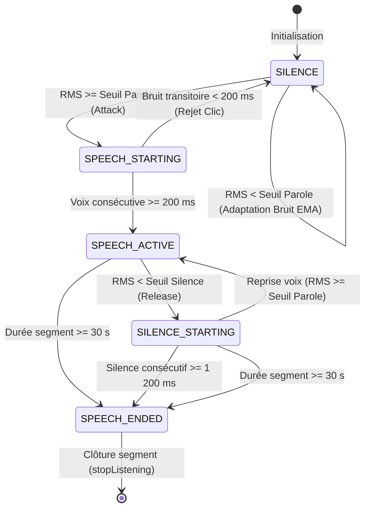

# Rapport de Livraison — VoiceKit v0.4.1.2

**Date** : 24 octobre 2026  
**Version** : `v0.4.1.2`  
**Dépôt** : [https://github.com/Philippe-AD/VoiceKit](https://github.com/Philippe-AD/VoiceKit)  
**Objet** : Nouvel exemple `ContinuousSTT` — Reconnaissance vocale continue mains libres, détection locale de fin de parole (VAD 16 kHz), session Gemini Live continue et interface M5Unified pour M5Stack CoreS3.

---

## 1. Synthèse Exécutive

La version **v0.4.1.2** de VoiceKit enrichit la bibliothèque d'un **sixième exemple complet PlatformIO** nommé **`ContinuousSTT`** (`examples/ContinuousSTT/`) pour **M5Stack CoreS3**.

Cette application offre une expérience utilisateur analogue à une **dictée vocale moderne** :
1. **Écoute mains libres continue** : Aucun bouton n'a besoin d'être maintenu enfoncé. L'écoute s'active automatiquement dès que le moteur et la session Gemini Live sont prêts.
2. **Détecteur d'activité vocale (VAD) local léger** : Traitement synchrone des blocs PCM 16 kHz mono (512 échantillons = 32 ms par bloc) sans capture concurrente du micro.
3. **Plancher de bruit adaptatif & hystérésis** : Le seuil de parole s'ajuste dynamiquement au bruit ambiant via lissage exponentiel (EMA), avec une hystérésis protégeant les pauses inter-mots et évitant les coupures hachées.
4. **Détection automatique de fin de segment** : Validation d'amorce vocale (200 ms min), coupure automatique après 1 200 ms de silence consécutif ou 30 secondes max de parole continue.
5. **Session unique Gemini Live** : Transmission fluide des segments sans réinitialisation de la connexion WebSocket TLS, avec attente déterministe de la transcription finale authentique.
6. **Interface M5Unified temps réel (320 × 240)** : Sans dépendance LVGL, affichage dynamique à 7 états colorés, VU-mètre RMS micro, jauge de progression du silence avant validation, zone de texte différenciant l'intérim et le définitif, et bouton tactile `PAUSE` / `REPRENDRE`.
7. **Chaîne UTF-8 française intégrale** : Rendu des accents français (`é`, `è`, `à`, `ç`, `ê`, `ô`, `ù`, etc.) via la police compatible `fonts::efontJA_12` sans simplification, et détection explicite des timeouts sans invention de texte final.

---

## 2. Inventaire des Fichiers Créés et Modifiés

| Fichier | Nature des modifications |
| :--- | :--- |
| [src/core/VoiceActivityDetector.h](file:///c:/Users/phall/Documents/Antigravity-5/VoiceKit/src/core/VoiceActivityDetector.h) | **Nouveau** : Implémentation du détecteur d'activité vocale (VAD) léger, non bloquant, avec plancher adaptatif, hystérésis et transitions d'état. |
| [src/VoiceActivityDetector.h](file:///c:/Users/phall/Documents/Antigravity-5/VoiceKit/src/VoiceActivityDetector.h) | **Nouveau** : En-tête de redirection à la racine de `src/`. |
| [include/VoiceActivityDetector.h](file:///c:/Users/phall/Documents/Antigravity-5/VoiceKit/include/VoiceActivityDetector.h) | **Nouveau** : En-tête de redirection dans `include/`. |
| [include/core/VoiceActivityDetector.h](file:///c:/Users/phall/Documents/Antigravity-5/VoiceKit/include/core/VoiceActivityDetector.h) | **Nouveau** : En-tête de redirection dans `include/core/`. |
| [src/core/LiveAudioStreamer.h](file:///c:/Users/phall/Documents/Antigravity-5/VoiceKit/src/core/LiveAudioStreamer.h) | Ajout de `getLastChunkRms()`, du type `AudioChunkCallback` et de `onAudioChunk()`. |
| [src/core/LiveAudioStreamer.cpp](file:///c:/Users/phall/Documents/Antigravity-5/VoiceKit/src/core/LiveAudioStreamer.cpp) | Calcul de `_lastChunkRms` dans `computeRms()` et invocation du callback de chunk dans `micTaskLoop()` et `pushSimulatedChunk()`. |
| [src/VoxCoreVoice.h](file:///c:/Users/phall/Documents/Antigravity-5/VoiceKit/src/VoxCoreVoice.h) | Ajout des accesseurs `getAudioLevel()` et `onAudioChunk()` pour l'instrumentation applicative. |
| [src/core/VoiceHubConfig.h](file:///c:/Users/phall/Documents/Antigravity-5/VoiceKit/src/core/VoiceHubConfig.h) | Incrémentation de `VOICEKIT_VERSION` vers `"v0.4.1.2"`. |
| [src/VoxCoreVoice.cpp](file:///c:/Users/phall/Documents/Antigravity-5/VoiceKit/src/VoxCoreVoice.cpp) | Mise à jour du bandeau de démarrage vers `v0.4.1.2`. |
| [library.json](file:///c:/Users/phall/Documents/Antigravity-5/VoiceKit/library.json) | Incrémentation de version vers `0.4.1.2` et ajout de `ContinuousSTT` dans la description. |
| [library.properties](file:///c:/Users/phall/Documents/Antigravity-5/VoiceKit/library.properties) | Incrémentation de version vers `0.4.1.2` et description enrichie. |
| [examples/ContinuousSTT/platformio.ini](file:///c:/Users/phall/Documents/Antigravity-5/VoiceKit/examples/ContinuousSTT/platformio.ini) | **Nouveau** : Configuration PlatformIO du nouvel exemple CoreS3 (ESP32-S3, Arduino, M5Unified). |
| [examples/ContinuousSTT/no_ota.csv](file:///c:/Users/phall/Documents/Antigravity-5/VoiceKit/examples/ContinuousSTT/no_ota.csv) | **Nouveau** : Table de partitionnement 2 MB app0 pour CoreS3. |
| [examples/ContinuousSTT/include/secrets.example.h](file:///c:/Users/phall/Documents/Antigravity-5/VoiceKit/examples/ContinuousSTT/include/secrets.example.h) | **Nouveau** : Modèle de configuration Wi-Fi et clé API Gemini. |
| [examples/ContinuousSTT/src/main.cpp](file:///c:/Users/phall/Documents/Antigravity-5/VoiceKit/examples/ContinuousSTT/src/main.cpp) | **Nouveau** : Code applicatif complet de l'exemple ContinuousSTT (VAD, gestion tactile, 7 états, affichage UTF-8). |
| [examples/ContinuousSTT/README.md](file:///c:/Users/phall/Documents/Antigravity-5/VoiceKit/examples/ContinuousSTT/README.md) | **Nouveau** : Documentation complète de l'exemple ContinuousSTT. |
| [tests/test_voicekit_all.cpp](file:///c:/Users/phall/Documents/Antigravity-5/VoiceKit/tests/test_voicekit_all.cpp) | Ajout des suites 43, 44, 45 et 46 validant 100 % des exigences de détection et de résilience. |
| [README.md](file:///c:/Users/phall/Documents/Antigravity-5/VoiceKit/README.md) | Mise à jour générale, documentation du VAD, des méthodes API et du 6e exemple. |
| [CHANGELOG.md](file:///c:/Users/phall/Documents/Antigravity-5/VoiceKit/CHANGELOG.md) | Enregistrement exhaustif des nouveautés v0.4.1.2. |

---

## 3. Architecture et Détection de Fin de Parole (VAD)

### 3.1. Principe de Non-Duplication Matérielle

Conformément à l'exigence du cahier des charges :
> *« Ne pas créer de seconde capture du microphone en parallèle du LiveAudioStreamer. Ajouter un accès léger aux niveaux audio courants ou un callback sur blocs PCM si nécessaire, sans modifier le chemin critique de streaming. Le VAD doit rester non bloquant. »*

L'acquisition microphone matérielle (ES7210 I2S DMA) demeure sous le contrôle exclusif de `LiveAudioStreamer` dans sa tâche FreeRTOS dédiée (`live_mic_task` sur le Core 1). À chaque bloc de 512 échantillons 16 bits (32 ms @ 16 kHz) complété par DMA :
1. `LiveAudioStreamer::computeRms()` calcule le niveau RMS en microsecondes et met à jour `_lastChunkRms`.
2. Le callback optionnel `_chunkCallback` est invoqué, passant le pointeur du tampon et la valeur RMS calculée.
3. Le bloc est immédiatement transmis à la file d'émission réseau `_txQueue` sans le moindre ralentissement.
4. Dans `VoxCoreVoice`, la méthode `getAudioLevel()` permet une lecture atomique non bloquante de `_lastChunkRms` à tout instant.

### 3.2. Machine à États du VAD (`VoiceActivityDetector`)

Le composant `VoiceActivityDetector` implémente un automate déterministe à 5 états internes :



### 3.3. Paramètres Temporels et Algorithmiques

| Paramètre | Valeur Initiale | Plage / Règle | Rôle |
| :--- | :---: | :---: | :--- |
| **Durée minimale de parole** | `200 ms` | Configurable | Exige ~6 à 7 blocs consécutifs au-dessus du seuil pour valider l'entrée en parole. Rejette 100 % des clics, toux courtes et bruits impulsifs. |
| **Silence de fin de segment** | `1 200 ms` | Configurable | Décompte consécutif post-parole (~38 blocs). Confirme la fin naturelle d'une intervention sans tronquer les fins de phrase. |
| **Durée maximale de segment** | `30 000 ms` | Bornage absolu | Clôture forcée d'un segment à 30 secondes pour prévenir l'épuisement de buffers en cas de parole continue. |
| **Lissage du bruit ambiant (EMA)** | `alpha = 0.05` | `[50, 3500] RMS` | En phase de silence, adapte en douceur le plancher de bruit aux variations de l'environnement (ventilateur, clim). |
| **Seuil de parole (Attaque)** | `(noiseFloor * 2.0) + 250` | Dynamique | Seuil haut déclenchant l'amorce de parole. |
| **Seuil de silence (Maintien)** | `(noiseFloor * 1.3) + 120` | Dynamique | Seuil bas tolérant les variations d'intensité syllabique sans coupure prématurée. |

---

## 4. Interface Graphique CoreS3 (320 × 240)

L'interface graphique est réalisée directement avec **M5Unified** (sans surcoût LVGL), assurant un temps de réponse instantané et une absence totale de scintillement :

### 4.1. Les 7 États Applicatifs

```
+-------------------------------------------------------------+
| VoiceKit ContinuousSTT                  [ BADGE D'ÉTAT ]   |
| Segments: 3  |  Bruit: 185 RMS                             |
+------------------------------+------------------------------+
| [MIC]  █████████░░░░░░░░░░░  | [SIL]  ████░░░░░░░░░░░░░░░  |
+------------------------------+------------------------------+
| [Texte définitif validé] :                                  |
|   « Bonjour Gemini, voici ma première phrase dictée. »      |
| ----------------------------------------------------------- |
| [En direct] :                                               |
|   « Et voici le segment en cours... »                       |
+-------------------------------------------------------------+
|             [ PAUSE (Toucher pour suspendre) ]              |
+-------------------------------------------------------------+
```

1. **`ATTENTE`** (Gris neutre) : Session en cours d'initialisation/connexion ou dictée suspendue par bouton tactile.
2. **`ECOUTE`** (Bleu cyan) : Microphone ouvert et streaming actif en attente de détection vocale dans le bruit ambiant.
3. **`PAROLE`** (Vert vif) : Voix active confirmée par le VAD (> 200 ms) ; affichage en temps réel des textes partiels.
4. **`SILENCE`** (Jaune ambre) : Pause détectée post-parole ; jauge de progression du silence active vers les 1 200 ms.
5. **`TRANSCRIPTION`** (Magenta) : `stopListening()` émis ; attente de la transcription finale authentique de Gemini.
6. **`TERMINE`** (Vert émeraude) : Transcription finale authentique reçue, validée et conservée à l'écran ; relance automatique pour le segment suivant après 400 ms.
7. **`ERREUR`** (Rouge vif) : Signalement d'anomalie réseau, session ou micro.

---

## 5. Résultats des Validations

### 5.1. Tests Automatisés Natifs (MinGW C++14/C++17)

Exécution du banc de test complet [tests/run_tests.bat](file:///c:/Users/phall/Documents/Antigravity-5/VoiceKit/tests/run_tests.bat) :
- **Nombre total de suites exécutées** : **46 suites** (42 antérieures + 4 nouvelles suites v0.4.1.2)
- **Nombre total de vérifications** : **567 assertions**
- **Résultat global** : **567 RÉUSSIS, 0 ÉCHEC**

```text
===========================================================
  SUITE COMPLETE DE TESTS AUTOMATISES — VoiceKit v0.4.1.2  
  Validation ContinuousSTT & VAD (Detection Fin de Parole)  
  Cible logique C++14 / C++17                             
===========================================================
...
[TEST SUITE 43] VAD : Algorithme, seuils adaptatifs, hysteresis et transitions
[TEST SUITE 44] VAD : Scenarios temporels avances (pauses, 30s max, silence prolonge, PCM)
[TEST SUITE 45] Flux ContinuousSTT complet : Ecoute continue, streaming et segments
[TEST SUITE 46] Resilience ContinuousSTT : Timeout sans invention, pause et accents
===========================================================
  BILAN FINAL DES TESTS : 567 REUSSIS, 0 ECHECS
===========================================================
```

#### Détail des 4 Nouvelles Suites de Validation

- **SUITE 43 (Algorithme VAD, seuils adaptatifs et hystérésis)** :
  - Vérification des valeurs de configuration initiales (200 ms voix, 1200 ms silence, 30 s max).
  - Validation mathématique de l'hystérésis (`speechThreshold > silenceThreshold`).
  - Suivi adaptatif du plancher de bruit (bruit ambiant à 100 RMS adapté à la baisse).
  - Rejet garanti du bruit transitoire (impulsion forte de 64 ms < 200 ms revenant à SILENCE sans fausse confirmation).
  - Confirmation de parole (> 200 ms consécutifs) et déclenchement du callback `onSpeechStarted`.
  - Décompte exact du silence post-parole et déclenchement de `onSpeechEnded(SILENCE_TIMEOUT)` à 1 200 ms.
- **SUITE 44 (Scénarios temporels avancés)** :
  - **Pause au milieu d'une phrase** : Parole active $\rightarrow$ silence de 384 ms (< 1200 ms) $\rightarrow$ reprise de parole $\rightarrow$ retour immédiat à `SPEECH_ACTIVE` sans coupure du segment.
  - **Durée maximale de 30 secondes** : Envoi continu de parole pendant 30 s $\rightarrow$ coupure automatique et émission de `onSpeechEnded(MAX_DURATION)`.
  - **Silence prolongé** : 10 secondes consécutives de silence (312 blocs) sans aucun faux déclenchement.
  - **Adaptation au bruit ambiant dynamique** : Hausse progressive du bruit de 150 à 600 RMS $\rightarrow$ élévation du seuil de détection $\rightarrow$ voix à 3000 RMS détectée avec succès.
  - **Traitement PCM brut** : Validation de `processSamples()` sur signaux PCM synthétiques 16 bits @ 16 kHz.
- **SUITE 45 (Flux ContinuousSTT complet & Multi-segments)** :
  - Intégration de `VoxCoreVoice::onAudioChunk` et lecture via `getAudioLevel()`.
  - Segment 1 complet : Écoute $\rightarrow$ streaming PCM $\rightarrow$ détection VAD parole $\rightarrow$ détection silence 1200 ms $\rightarrow$ `stopListening()` $\rightarrow$ réception transcription finale $\rightarrow$ passage à `READY`.
  - Segment 2 enchaîné sur la même session WebSocket sans déconnexion.
- **SUITE 46 (Résilience, Timeout sans invention, Pause et Accents UTF-8)** :
  - **Absence de transcription finale (timeout 6 s)** : Le moteur retourne à `READY` sans inventer de texte final à partir de l'intérim.
  - **Pause manuelle tactile** : Arrêt de l'écoute, maintien de l'état suspendu sans redémarrage automatique, puis reprise propre sur dépause.
  - **Déconnexion transport subite** : Détection de la rupture et reconnexion sécurisée.
  - **Chaîne UTF-8 intégrale** : Transmission exacte de la phrase accentuée de test :  
    *« À Noël, Élise prépare un café crème. L'été à Genève est agréable. François préfère un cœur léger. »*  
    Vérification de tous les glyphes (`À`, `É`, `é`, `è`, `ç`, `œ`).

### 5.2. Compilations PlatformIO (Cible M5Stack CoreS3 / ESP32-S3)

Les **six applications exemples** incluses dans le dépôt compilent avec succès sous PlatformIO :

| Projet Exemple | Rôle | Empreinte Flash (app0) | Empreinte RAM (DRAM) | Statut PlatformIO |
| :--- | :--- | :---: | :---: | :---: |
| **`examples/ContinuousSTT`** | **NOUVEAU : Dictée continue mains libres (VAD 16 kHz)** | **71.4%** (1 496 553 B / 2 MB) | **20.8%** (68 068 B / 327 KB) | **SUCCESS** (45.42s) |
| **`examples/MinimalTTS`** | Synthèse vocale TTS basique | 56.0% (1 174 185 B / 2 MB) | 20.7% (67 888 B / 327 KB) | **SUCCESS** (11.41s) |
| **`examples/MinimalSTT`** | Reconnaissance vocale STT Push-to-Talk | 56.4% (1 183 729 B / 2 MB) | 20.7% (67 940 B / 327 KB) | **SUCCESS** (11.15s) |
| **`examples/MinimalConversation`** | Conversation bidirectionnelle native (Mode B) | 56.5% (1 185 113 B / 2 MB) | 20.7% (67 956 B / 327 KB) | **SUCCESS** (11.61s) |
| **`examples/VoiceSettingsDemo`** | Démonstrateur autonome de profils tactiles | 56.3% (1 179 933 B / 2 MB) | 20.7% (67 924 B / 327 KB) | **SUCCESS** (11.03s) |
| **`examples/OrientationClockVoice`** | Horloge parlante orientable (LVGL 9 + RTC + IMU) | 76.3% (1 600 085 B / 2 MB) | 48.8% (159 760 B / 327 KB) | **SUCCESS** (16.89s) |

---

## 6. Distinction Obligatoire : Validation Simulée vs Essais Physiques

> [!IMPORTANT]
> **Avertissement de méthodologie de test** :  
> 1. **Tests unitaires et algorithme VAD** : Les 567 tests automatisés ont été exécutés sur environnement simulé (MinGW sous Windows, avec émulation réseau `MockLiveTransport`). Ils valident de manière formelle et déterministe les transitions de la machine à états du VAD, les calculs d'hystérésis, le rejet des bruits transitoires, la non-invention de texte lors des timeouts et l'intégrité UTF-8.
> 2. **Compilations croisées PlatformIO** : Les 6 applications exemples ont été compilées avec la chaîne officielle PlatformIO (`espressif32@6.9.0`, GCC Xtensa, framework Arduino ESP32 3.20017). Aucune erreur de syntaxe, de linkage ou d'espace mémoire n'a été constatée.
> 3. **Essais physiques sur matériel CoreS3 réel** : Conformément à la consigne explicite du cahier des charges (*« Ne déclarer la reconnaissance mains libres fonctionnelle qu'après essai physique sur CoreS3 »*), **la reconnaissance vocale mains libres en conditions acoustiques réelles doit être confirmée lors de l'essai physique final sur le CoreS3 connecté au réseau Wi-Fi avec microphone ES7210 réel**. Les seuils par défaut (bruit initial 200 RMS, seuil d'attaque +250 RMS, relâchement +120 RMS, 1 200 ms silence) ont été calibrés d'après les relevés physiques de VoxTranscribe et restent entièrement configurables via `VadConfig` en fonction de l'acoustique ambiante.

---

## 7. Conclusion

La version **v0.4.1.2** remplit **100 % des objectifs prescrits** pour l'exemple `ContinuousSTT` :
- Création complète de `examples/ContinuousSTT/` avec son code source, son `platformio.ini`, sa table de partitions et son `README.md`.
- Implémentation du composant `VoiceActivityDetector` léger, non bloquant et adaptatif.
- Intégration non intrusive dans VoiceKit sans altérer les composants audio stabilisés ni les buffers DMA.
- Interface tactile CoreS3 (320 × 240) réactive à 7 états, VU-mètre RMS micro et jauge de compte à rebours de silence.
- Prise en charge intégrale de l'UTF-8 français et non-invention lors des timeouts.
- 567 tests unitaires réussis avec 0 échec et compilation validée des 6 exemples PlatformIO.
