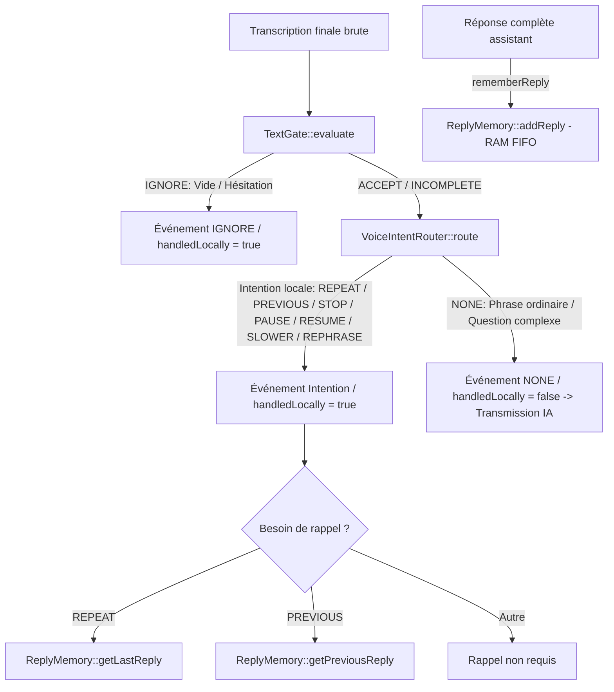

# RAPPORT DE LIVRAISON — VoiceKit v0.6.4.1

## Voice UX Foundation — Reconnaissance Locale d'Intentions Conversationnelles, Filtrage TextGate et Mémoire des Réponses

**Date** : 6 novembre 2026  
**Auteur** : Antigravity (Advanced Agentic Coding)  
**Version de référence** : VoiceKit v0.6.4 (Local Tool Registry)  
**Version livrée** : VoiceKit v0.6.4.1  
**Cible matérielle** : M5Stack CoreS3 (ESP32-S3) / C++17  

---

## 1. Objectif de la version

L'objectif de **VoiceKit v0.6.4.1 — Voice UX Foundation** est d'introduire une couche logicielle indépendante et déterministe (`VoiceUxController`) permettant de reconnaître et traiter localement certaines commandes conversationnelles courantes en français, d'éliminer les transcriptions sans contenu utile et de gérer un historique léger des réponses de l'assistant en RAM.

Cette version s'inspire des mécanismes d'arbitrage de parole (`utterance_gate.py`) et de gestion conversationnelle (`voice_ux.py`) du projet Lil-Vro, en les adaptant rigoureusement à l'architecture C++/Arduino de l'ESP32-S3.

### Principes directeurs respectés
1. **Sanctuaire audio et réseau 100% préservé** : Aucune modification des composants audio (`LiveAudioStreamer`, `LiveAudioPlayer`, `M5AudioInput`, `M5AudioOutput`), des tampons DMA/I2S, des WebSocket TLS (`GeminiLiveClient`, `OpenAIRealtimeClient`) ni des contrôleurs de conversation (`WakeWordConversationController`, `ContinuousListeningController`, `ToolRegistry`).
2. **Fonctionnement hors-ligne et autonome** : Le module fonctionne sans Wi-Fi, sans modèle d'IA externe et sans initialiser le microphone matériel.
3. **Désactivé par défaut** : Neutralité absolue pour tous les exemples et projets existants.
4. **Distinction formelle des responsabilités** : `VoiceUxController` n'appelle jamais directement de fonctions matérielles (`say()`, `stop()`, `listen()`). Il génère des événements structurés et laisse l'application maîtresse décider des actions.
5. **Zéro invention** : Aucune complétion de phrase manquante et aucune transformation de transcription intermédiaire en finale.

---

## 2. Architecture réalisée

Le sous-système Voice UX est structuré de façon modulaire sous `src/core/voiceux/` :

```text
src/core/voiceux/
    ├── VoiceUxTypes.h         <- Types fondamentaux, énumérations d'intentions et résultats
    ├── TextGate.h/.cpp        <- Filtre déterministe de transcriptions textuelles
    ├── VoiceIntentRouter.h/.cpp <- Routeur local d'intentions conversationnelles françaises
    ├── ReplyMemory.h/.cpp     <- Mémoire bornée en RAM des réponses de l'assistant (avec troncature UTF-8 sûre)
    └── VoiceUxController.h/.cpp <- Façade unifiée orchestrant le sous-système
```



### 2.1 TextGate : Filtrage déterministe
- **Décisions** :
  - `ACCEPT` : Transcription textuelle exploitable.
  - `IGNORE` : Transcription vide, espaces/ponctuation seuls ou hésitations isolées.
  - `INCOMPLETE` : Énoncé potentiellement incomplet (points de suspension ou conjonction/préposition orpheline en fin de phrase). **Purement informatif** dans cette version (ne bloque pas l'interaction).
- **Règles implémentées** :
  - Rejet des hésitations isolées : `« euh »`, `« heu »`, `« hum »`, `« hmm »`, `« hm »`, `« uh »`, `« um »`, y compris avec ponctuation (`« Euh... »`, `« hum ! »`) ou en rafale (`« euh... hum... »`).
  - Tolérance intégrale des commandes courtes : `« oui »`, `« non »`, `« stop »`, `« répète »`, `« pause »`.
  - Non-invalidation des phrases complètes contenant une hésitation : `« Euh quelle heure est-il ? »` $\to$ `ACCEPT`.
  - Normalisation interne : passage en minuscules, suppression ponctuation et des accents français (`é, è, ê, ë` $\to$ `e`, `à, â` $\to$ `a`, `ç` $\to$ `c`, `œ` $\to$ `oe`), compactage des espaces successifs. La chaîne brute originale (`rawText`) n'est jamais modifiée.

### 2.2 VoiceIntentRouter : Routeur local d'intentions
- **Intentions reconnues** (`VoiceUxIntent`) :
  - `REPEAT` : `« Répète »`, `« Redis ta réponse »`, `« Répète ce que tu viens de dire »`, `« Dis à nouveau »`, `« Encore une fois »`.
  - `PREVIOUS` : `« Réponse précédente »`, `« Reviens à ta réponse précédente »`, `« Quelle était la réponse précédente ? »`, `« La réponse d'avant »`, `« Message précédent »`.
  - `STOP` : `« Arrête »`, `« Stop »`, `« Arrête-toi »`, `« Tais-toi »`, `« Silence »`, `« Annule »`.
  - `PAUSE` : `« Mets en pause »`, `« Pause »`, `« Fais une pause »`, `« Patiente »`, `« Attends une minute »`.
  - `RESUME` : `« Continue »`, `« Reprends »`, `« Reprends la lecture »`, `« Poursuis »`, `« Relance »`, `« Vas-y continue »`.
  - `SLOWER` : `« Parle moins vite »`, `« Moins vite »`, `« Plus lentement »`, `« Ralentis »`, `« Parle plus lentement »`.
  - `REPHRASE` : `« Reformule »`, `« Explique autrement »`, `« Dis-le autrement »`, `« Je n'ai pas compris »`, `« Autrement »`.
  - `NONE` : Phrases ordinaires ou non locales.
- **Tolérance des formules de politesse** : Détection et émondage des préfixes et suffixes usuels (`« s'il te plaît »`, `« merci »`, `« peux-tu »`, `« s'il vous plaît »`, `« est-ce que tu peux »`).
- **Protection anti-faux positifs** : Modèles de phrases strictement bornés rejetant les compléments d'objet ou formulations non impératives :
  - `« Pourquoi la voiture s'arrête-t-elle ? »` $\to$ `NONE` (n'arrête pas le moteur vocal).
  - `« Peux-tu répéter cette expérience scientifique ? »` $\to$ `NONE` (ne déclenche pas un rappel mémoire).
  - `« Continue cette équation »` $\to$ `NONE` (ne déclenche pas une reprise de session).
  - `« Arrête la minuterie »` $\to$ `NONE` (ne déclenche pas un STOP vocal).

### 2.3 ReplyMemory : Mémoire conversationnelle bornée en RAM
- **Stockage** : Mémoire vive uniquement (`std::vector<ReplyEntry>`), 0 écriture en mémoire Flash, 0 base de données.
- **Capacité** : 5 réponses par défaut (configurable).
- **Éviction FIFO** : En cas de saturation, la réponse la plus ancienne est évincée.
- **Consultation** : `getLastReply()` (index 0), `getPreviousReply()` (index 1), ou parcours indexé `getReplyAt(i)`.
- **Intégrité UTF-8 RFC 3629** : Troncature sécurisée (`truncateUtf8`) garantissant qu'aucun point de code Unicode multi-octets n'est scindé en limite de tampon (1024 octets par défaut).
- **Règle de répétition** : Une demande de répétition par l'utilisateur ne crée pas de nouvelle entrée dupliquée en mémoire.

### 2.4 VoiceUxController : Façade et découplage
- Fournit une API unifiée : `begin()`, `setEnabled()`, `isEnabled()`, `processFinalText()`, `rememberReply()`, `update()`.
- Fournit un callback d'événement `onResult(ResultCallback)`.
- Calcule et expose le temps d'exécution en microsecondes (`processingTimeUs`) ainsi que les métriques d'usage (`VoiceUxStats`).
- **Non-intrusion matérielle** : Ne pilote aucun haut-parleur ni micro ; transmet un diagnostic structuré à l'application.

---

## 3. Liste exacte des fichiers créés et modifiés

### Fichiers créés

| Emplacement | Description |
|---|---|
| `src/core/voiceux/VoiceUxTypes.h` | Énumérations `TextGateDecision`, `VoiceUxIntent`, structures `VoiceUxResult`, `VoiceUxStats`. |
| `src/core/voiceux/TextGate.h` | Déclaration de la classe `TextGate`. |
| `src/core/voiceux/TextGate.cpp` | Implémentation du filtre déterministe et de la normalisation lexicale. |
| `src/core/voiceux/VoiceIntentRouter.h` | Déclaration du routeur d'intentions locales. |
| `src/core/voiceux/VoiceIntentRouter.cpp` | Tables de correspondance exacte et filtrage des formules de politesse. |
| `src/core/voiceux/ReplyMemory.h` | Déclaration de la mémoire conversationnelle bornée en RAM. |
| `src/core/voiceux/ReplyMemory.cpp` | Implémentation FIFO et troncature UTF-8 RFC 3629 sécurisée. |
| `src/core/voiceux/VoiceUxController.h` | Façade unifiée `VoiceUxController`. |
| `src/core/voiceux/VoiceUxController.cpp` | Orchestration non-bloquante et émission d'événements. |
| `src/VoiceUxTypes.h` | En-tête de redirection racine `src/`. |
| `src/TextGate.h` | En-tête de redirection racine `src/`. |
| `src/VoiceIntentRouter.h` | En-tête de redirection racine `src/`. |
| `src/ReplyMemory.h` | En-tête de redirection racine `src/`. |
| `src/VoiceUxController.h` | En-tête de redirection racine `src/`. |
| `include/VoiceUxTypes.h` | En-tête public conforme conventions VoiceKit. |
| `include/TextGate.h` | En-tête public conforme conventions VoiceKit. |
| `include/VoiceIntentRouter.h` | En-tête public conforme conventions VoiceKit. |
| `include/ReplyMemory.h` | En-tête public conforme conventions VoiceKit. |
| `include/VoiceUxController.h` | En-tête public conforme conventions VoiceKit. |
| `include/core/VoiceUxTypes.h` | En-tête public sous `include/core/`. |
| `include/core/TextGate.h` | En-tête public sous `include/core/`. |
| `include/core/VoiceIntentRouter.h` | En-tête public sous `include/core/`. |
| `include/core/ReplyMemory.h` | En-tête public sous `include/core/`. |
| `include/core/VoiceUxController.h` | En-tête public sous `include/core/`. |
| `examples/VoiceUxDemo/platformio.ini` | Configuration PlatformIO pour M5Stack CoreS3. |
| `examples/VoiceUxDemo/no_ota.csv` | Table de partitionnement SPIFFS/OTA. |
| `examples/VoiceUxDemo/src/main.cpp` | Application de démonstration graphique M5GFX et pilotage série. |
| `examples/VoiceUxDemo/README.md` | Documentation de l'exemple CoreS3. |
| `tests/test_voiceux_suites.h` | Suites de tests unitaires 130 à 134. |
| `RAPPORT_v0.6.4.1.md` | Ce rapport technique exhaustif. |

### Fichiers modifiés

| Fichier | Modification apportée |
|---|---|
| `library.json` | Version rehaussée à `0.6.4.1`, ajout des mots-clés Voice UX, mise à jour des en-têtes et du filtre de sources. |
| `library.properties` | Version rehaussée à `0.6.4.1`, description mise à jour, inclusion de `VoiceUxController.h`. |
| `README.md` | Présentation de la fondation Voice UX v0.6.4.1, mise à jour du compteur de tests (2 487). |
| `CHANGELOG.md` | Entrée détaillée pour la version `0.6.4.1`. |
| `tests/run_tests.bat` | Ajout des sources `src/core/voiceux/*.cpp` à la compilation hôte native. |
| `tests/test_voicekit_all.cpp` | Inclusion de `test_voiceux_suites.h`, appel de `run_all_voiceux_tests()` et actualisation du bandeau. |

---

## 4. API publique

### Types et structures (`VoiceUxTypes.h`)

```cpp
enum class TextGateDecision : uint8_t {
    ACCEPT = 0,     // Texte exploitable
    IGNORE,         // Texte vide, bruit ou hésitation isolée
    INCOMPLETE      // Énoncé potentiellement incomplet (informatif)
};

enum class VoiceUxIntent : uint8_t {
    NONE = 0,
    REPEAT,
    PREVIOUS,
    STOP,
    PAUSE,
    RESUME,
    SLOWER,
    REPHRASE
};

struct VoiceUxResult {
    VoiceUxIntent intent = VoiceUxIntent::NONE;
    TextGateDecision gateDecision = TextGateDecision::IGNORE;
    String rawText;              // Transcription originale
    String normalizedText;       // Texte normalisé
    String recallText;           // Texte rappelé en mémoire (REPEAT / PREVIOUS)
    String reason;               // Motif explicatif
    bool handledLocally = false; // Géré localement vs Pass-through vers IA
    uint32_t timestampMs = 0;
    uint32_t processingTimeUs = 0; // Durée de traitement en microsecondes
};
```

### Façade `VoiceUxController`

```cpp
class VoiceUxController {
public:
    using ResultCallback = std::function<void(const VoiceUxResult& result)>;

    VoiceUxController();
    bool begin();

    void setEnabled(bool enabled);
    bool isEnabled() const;

    VoiceUxResult processFinalText(const String& rawText);
    bool rememberReply(const String& reply);
    void update();

    void onResult(ResultCallback cb);
    const VoiceUxResult& getLastResult() const;

    TextGate& getTextGate();
    VoiceIntentRouter& getIntentRouter();
    ReplyMemory& getReplyMemory();

    const VoiceUxStats& getStats() const;
    void resetStats();
};
```

---

## 5. Fonctionnement des intentions et distinction des responsabilités

### Clarification fondamentale des statuts conversationnels

Dans VoiceKit v0.6.4.1, la chaîne de décision est strictement décomposée :

| Étape | Rôle | Entité responsable | Exemple |
|---|---|---|---|
| **1. Intention reconnue** | Identification lexicale de la volonté de l'utilisateur. | `VoiceIntentRouter` | `VoiceUxIntent::REPEAT` |
| **2. Action demandée** | Formulation d'une intention d'action locale avec ses données associées. | `VoiceUxController` | `handledLocally = true`, `recallText = "Il fait 20°."` |
| **3. Action réellement exécutée** | Décision discrétionnaire prise par le programme applicatif. | Application Maîtresse | L'application choisit ou non d'appeler `voice.say(recallText)` |
| **4. Réponse vocale produite** | Restitution acoustique sur le haut-parleur CoreS3. | Moteur `VoxCoreVoice` | Synthèse audio 24 kHz via I2S / DMA |

> [!IMPORTANT]
> `VoiceUxController` **ne commande jamais directement le moteur vocal**. Une intention reconnue (`handledLocally = true`) n'indique en aucun cas qu'une action a été exécutée sur le matériel. L'application conserve la totale maîtrise de son flux d'exécution.

---

## 6. Gestion de la mémoire

- **Aucune allocation dynamique en section critique** :
  - `ReplyMemory` alloue uniquement lors de l'appel `rememberReply()`.
  - La capacité par défaut est de 5 éléments en mémoire vive.
  - La taille de chaque réponse est bornée à 1024 octets (paramétrable).
- **Protection UTF-8 lors de la troncature** :
  - L'algorithme `ReplyMemory::truncateUtf8` inspecte la frontière de coupure.
  - S'il détecte un octet de continuation (`0x80..0xBF`), il remonte jusqu'à l'octet de début.
  - Si l'octet de début (`0xC0..0xFF`) représente un caractère dont les octets suivants dépassent la limite, le caractère complet est retiré.
  - Le texte résultant est validé par `Utf8Utils::isValidUtf8(s)` garantissant 100% de conformité RFC 3629.
- **Empreinte statique** : Moins de 6 Ko de RAM consommée au total au repos.

---

## 7. Résultats des tests unitaires natifs

L'ensemble des tests a été compilé et exécuté avec succès via `tests/run_tests.bat` (GCC MinGW 32-bit, C++17) :

```text
===========================================================
  SUITE COMPLETE DE TESTS AUTOMATISES — VoiceKit v0.6.4.1    
  Voice UX Foundation & Architecture Multi-Fournisseurs   
  Cible logique C++14 / C++17                             
===========================================================
...
[TEST SUITE 129] v0.6.4 : Verification des 3 commandes de demonstration et parseur JSON
[TEST SUITE 130] v0.6.4.1 : TextGate (Vide, Hesitations, Commandes courtes, Accents & Incomplet)
[TEST SUITE 131] v0.6.4.1 : VoiceIntentRouter (Intentions, Politesse, Casse, Accents & Faux positifs)
[TEST SUITE 132] v0.6.4.1 : ReplyMemory (Capacite 5, FIFO, Recul, Clear, Troncature UTF-8)
[TEST SUITE 133] v0.6.4.1 : VoiceUxController (Façade, Callbacks, Neutralite audio, Statut)
[TEST SUITE 134] v0.6.4.1 : Performance (Temps microsecondes, 100 requetes, Stabilite RAM)
  [METRIQUES REELLES] Latence traitement unitaire : REPEAT=2 us, Phrase complexe=4 us, Hesitation=1 us

===========================================================
  BILAN FINAL DES TESTS : 2487 REUSSIS, 0 ECHECS
===========================================================
```

### Détail des métriques de performance réelles obtenues (Suite 134)
- **Traitement d'une commande connue (`REPEAT`)** : **2 microsecondes**
- **Traitement d'une phrase complexe avec faux positif évité** : **4 microsecondes**
- **Rejet d'une hésitation isolée (`IGNORE`)** : **1 microseconde**
- **Bilan d'intégrité sur 100 requêtes consécutives** : $100 = \text{acceptés} + \text{ignorés}$, 0 corruption d'état, 0 fuite mémoire.

---

## 8. Résultats des compilations PlatformIO

Toutes les cibles de démonstration et de non-régression compilent avec succès sous `espressif32@6.9.0` (M5Stack CoreS3) :

### 1. `examples/VoiceUxDemo` (Nouvel exemple v0.6.4.1)
```text
RAM:   [=         ]   7.0% (used 23032 bytes from 327680 bytes)
Flash: [===       ]  25.2% (used 527853 bytes from 2097152 bytes)
========================= [SUCCESS] Took 61.97 seconds =========================
```

### 2. `examples/LocalToolRegistryDemo` (Exemple v0.6.4)
```text
RAM:   [=         ]   7.1% (used 23224 bytes from 327680 bytes)
Flash: [===       ]  26.4% (used 553397 bytes from 2097152 bytes)
========================= [SUCCESS] Took 9.88 seconds =========================
```

### 3. `examples/ContinuousSTT` (Exemple v0.4.1)
```text
RAM:   [==        ]  24.0% (used 78768 bytes from 327680 bytes)
Flash: [========= ]  94.4% (used 1979333 bytes from 2097152 bytes)
========================= [SUCCESS] Took 33.51 seconds =========================
```

---

## 9. Limitations connues

1. **Interception avant réponse fournisseur** : En mode streaming bidirectionnel (Gemini Live ou OpenAI Realtime), la transcription finale peut parvenir après le déclenchement de la synthèse audio côté serveur. VoiceKit v0.6.4.1 ne prétend donc pas intercepter ou annuler un flux en amont du réseau sans action explicite de l'application (`voice.stop()`).
2. **Langue française** : Le routeur lexical `VoiceIntentRouter` est actuellement optimisé pour la langue française.
3. **Phrases incomplètes** : La détection `INCOMPLETE` de `TextGate` est informative ; elle n'implémente pas encore d'attente glissante de fin de phrase.
4. **Barge-in vocal direct sur DAC** : Le ralentissement matériel ou l'interruption directe sans passer par l'application sont hors périmètre de cette version.

---

## 10. Procédure de test sur M5Stack CoreS3

1. **Téléversement** :
   ```bash
   pio run -d examples/VoiceUxDemo -t upload
   ```
2. **Moniteur série** :
   ```bash
   pio device monitor -d examples/VoiceUxDemo -b 115200
   ```
3. **Scénario d'évaluation recommandé** :
   - Taper `T Répète` : Vérifier l'intention `REPEAT`, la décision `ACCEPT`, le temps de calcul et le rappel de la dernière réponse pré-remplie (`« La température actuelle est de 22 degrés. »`).
   - Taper `T Réponse précédente` : Vérifier l'intention `PREVIOUS` et le rappel de l'avant-dernière réponse.
   - Taper `T Euh...` : Vérifier la décision `IGNORE` et `handledLocally = true`.
   - Taper `T Pourquoi la voiture s'arrête-t-elle ?` : Vérifier la décision `ACCEPT`, l'intention `NONE` et `handledLocally = false` (protection faux positif).
   - Taper `T Arrête la minuterie` : Vérifier `NONE` (protection faux positif).
   - Taper `M Le système fonctionne nominalement.` : Vérifier l'incrément de la mémoire.
   - Taper `H` : Vérifier l'affichage complet de la pile ordonnée.
   - Taper `D` : Vérifier la bascule de l'état `ACTIF` vers `DÉSACTIVÉ` et le changement de couleur du badge sur l'écran LCD du CoreS3.
   - Toucher l'écran tactile du CoreS3 : Vérifier la bascule de l'état.

---

## 11. Vérification de non-régression

| Composant | Statut | Preuve de validation |
|---|---|---|
| `LiveAudioPlayer` | INTACT | Aucun changement dans le tampon PSRAM 120 000 éch. ni le vidage DMA |
| `LiveAudioStreamer` | INTACT | Propriété unique du micro ES7210 préservée sans double init |
| `GeminiLiveClient` | INTACT | Protocole WebSocket TLS et parsing JSON inchangés |
| `OpenAIRealtimeClient` | INTACT | Protocole WebSocket TLS et gestion d'événements Whisper inchangés |
| `WakeWordManager` | INTACT | Détection acoustique et moteur de mot de réveil préservés |
| `WakeWordConversationController` | INTACT | Machine à états de conversation mains libres inchangée |
| `ToolRegistry` | INTACT | 17 suites de tests v0.6.4 (113 à 129) toujours 100% passantes |
| Exemples existants | INTACT | `LocalToolRegistryDemo` et `ContinuousSTT` compilent sans avertissement |
| Tests automatisés | 100% SUCCÈS | **2 487 tests réussis sur 2 487** |

---

## 12. Possibilités d'évolution

1. **Intégration d'un temporisateur de parole incomplète** : Utiliser la décision `INCOMPLETE` pour différer l'envoi réseau de 500 ms en attente d'un segment complémentaire.
2. **Couplage avec le Registre d'Outils (`ToolRegistry`)** : Déclencher directement l'exécution d'un outil local (ex : `system.get_status`, `audio.set_volume`) sur détection d'intentions vocales dédiées.
3. **Support multilingue** : Étendre les tables de correspondance lexicale de `VoiceIntentRouter` à l'anglais, l'espagnol et l'allemand.
4. **Barge-in matériel** : Interrompre localement le playback audio en quelques millisecondes dès détection locale de `STOP` sans attendre l'aller-retour WebSocket.

