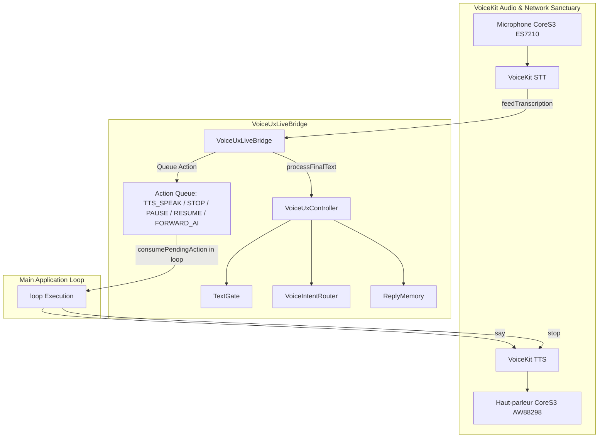

# RAPPORT DE LIVRAISON — VoiceKit v0.6.4.2

## Voice UX Live Bridge — Intégration STT Microphone CoreS3, Arbitrage d'Intentions Locales, Mémoire de Réponses & Restitution TTS

**Date** : 7 novembre 2026  
**Auteur** : Antigravity (Advanced Agentic Coding)  
**Version de référence** : VoiceKit v0.6.4.1 (Voice UX Foundation)  
**Version livrée** : VoiceKit v0.6.4.2  
**Cible matérielle** : M5Stack CoreS3 (ESP32-S3) / C++17  

---

## 1. Objectif et Contexte de la Version

L'objectif de **VoiceKit v0.6.4.2 — Voice UX Live Bridge** est d'établir le pont applicatif opérationnel permettant d'utiliser les composants de la fondation Voice UX introduits en v0.6.4.1 (`VoiceUxController`, `TextGate`, `VoiceIntentRouter`, `ReplyMemory`) avec de **véritables transcriptions vocales issues du microphone matériel du M5Stack CoreS3**, et de restituer vocalement les réponses locales sur le haut-parleur via le moteur TTS existant de VoiceKit.

### Exemple de cycle nominal local
```text
Utilisateur :
    "Répète"

Microphone CoreS3 (I2S / ES7210 16 kHz)
    ↓
VoiceKit STT (Streaming unitaire Gemini Live / OpenAI Realtime)
    ↓
Transcription finale confirmée : "Répète"
    ↓
VoiceUxLiveBridge / VoiceUxController
    ↓
TextGate (ACCEPT) → VoiceIntentRouter (Intention = REPEAT)
    ↓
ReplyMemory (Extraction de la dernière réponse complète mémorisée)
    ↓
Action structurée TTS_SPEAK mise en attente (ACTION_PENDING)
    ↓
Consommation sécurisée dans loop()
    ↓
VoiceKit TTS (Restitution PCM 24 kHz haute fidélité)
    ↓
Haut-parleur CoreS3 (I2S / AW88298)
```

La décision de répétition ou de retour à la réponse précédente est **entièrement locale et déterministe**, ne nécessitant aucun appel à un modèle conversationnel d'IA distant.

> [!NOTE]
> Comme précisé au cahier des charges, les services STT et TTS de base font appel aux API distantes configurées (Google Gemini ou OpenAI). La version ne prétend donc pas être entièrement hors-ligne, mais garantit que l'arbitrage conversationnel et le rappel de mémoire sont 100% locaux.

---

## 2. Architecture Réellement Implémentée

### 2.1 Le Composant `VoiceUxLiveBridge`
Un adaptateur indépendant et facultatif a été conçu et implémenté sous `src/core/voiceux/VoiceUxLiveBridge.h` et `src/core/voiceux/VoiceUxLiveBridge.cpp` avec redirection conforme dans `include/` et `src/`.



### 2.2 Principes directeurs et sûreté
1. **Sanctuaire audio 100% préservé** : Aucune modification des composants audio bas niveau (`LiveAudioStreamer`, `LiveAudioPlayer`, `M5AudioInput`, `M5AudioOutput`), des tampons DMA/I2S, des tâches FreeRTOS ni du mot de réveil « Bonjour ESP ».
2. **Aucune prise de possession directe du microphone** : Le pont ne pilote pas le matériel ; VoiceKit demeure l'unique propriétaire du microphone.
3. **Zéro opération audio dans les callbacks** : Les callbacks STT (`onTranscription`) se contentent d'injecter le texte dans le pont. Les actions de restitution (`TTS_SPEAK`) ou d'arrêt sont mises en attente (`ACTION_PENDING`) et consommées en toute sécurité depuis la boucle `loop()`.
4. **Protection anti-concurrence matérielle** :
   - `canStartListening()` interdit toute capture microphone pendant la restitution haut-parleur.
   - `canSpeak()` interdit tout déclenchement TTS pendant l'acquisition ou la transcription STT.
5. **Dédoublonnage et suivi de tour (`turnId`)** :
   - Rejet des transcriptions partielles (intérim).
   - Une transcription finale ne produit qu'une seule action par tour.
   - Rejet immédiat des événements tardifs d'un ancien tour (`turnId < activeTurnId`).
   - Rejet des transcriptions associées à un tour annulé par un STOP prioritaire.

---

## 3. Interfaces Utilisées dans VoiceKit

Le pont exploite exclusivement les interfaces publiques stabilisées de VoiceKit :
- `VoxCoreVoice` :
  - `startListening()` : Démarre la capture STT unitaire.
  - `stopListening()` : Clôture la capture et sollicite la transcription finale.
  - `say(text)` : Lance la synthèse vocale TTS.
  - `stop()` : Interrompt la restitution audio en cours.
  - `isReady()`, `isListening()`, `isSpeaking()`, `getState()`.
  - Callbacks : `onListeningStarted()`, `onListeningFinished()`, `onTranscription()`, `onSpeechStarted()`, `onSpeechFinished()`, `onError()`.
- `VoiceUxController` :
  - `processFinalText(rawText)` : Évaluation déterministe par `TextGate` et `VoiceIntentRouter`.
  - `rememberReply(reply)` : Mémorisation d'une réponse validée.
  - `getReplyMemory()` : Consultation directe de l'historique en RAM.

---

## 4. Fichiers Créés et Modifiés

### 4.1 Fichiers créés
| Emplacement | Rôle |
|---|---|
| `src/core/voiceux/VoiceUxLiveBridge.h` | Déclaration de la classe `VoiceUxLiveBridge`, énumérations d'états et actions. |
| `src/core/voiceux/VoiceUxLiveBridge.cpp` | Implémentation du pont applicatif, gestion des tours et filtrage de concurrence. |
| `src/VoiceUxLiveBridge.h` | En-tête de redirection racine `src/`. |
| `include/VoiceUxLiveBridge.h` | En-tête public conforme conventions VoiceKit. |
| `include/core/VoiceUxLiveBridge.h` | En-tête public sous `include/core/`. |
| `include/voiceux/VoiceUxLiveBridge.h` | En-tête public sous `include/voiceux/`. |
| `include/core/voiceux/VoiceUxLiveBridge.h` | En-tête public sous `include/core/voiceux/`. |
| `examples/VoiceUxLiveDemo/platformio.ini` | Configuration PlatformIO pour M5Stack CoreS3. |
| `examples/VoiceUxLiveDemo/no_ota.csv` | Table de partitionnement SPIFFS/OTA. |
| `examples/VoiceUxLiveDemo/include/AppConfig.h` | Configuration applicative (volume, timeouts, mémoires). |
| `examples/VoiceUxLiveDemo/include/secrets.example.h` | Modèle de configuration des identifiants Wi-Fi et clés API. |
| `examples/VoiceUxLiveDemo/src/main.cpp` | Application CoreS3 avec interface graphique M5GFX et console série. |
| `examples/VoiceUxLiveDemo/README.md` | Guide d'utilisation et procédure de test de la démonstration. |
| `RAPPORT_v0.6.4.2.md` | Le présent rapport technique exhaustif. |

### 4.2 Fichiers modifiés
| Emplacement | Rôle |
|---|---|
| `tests/run_tests.bat` | Ajout de `src/core/voiceux/VoiceUxLiveBridge.cpp` à la compilation MinGW native. |
| `tests/test_voiceux_suites.h` | Ajout des suites 135, 136, 137 et 138 (92 nouveaux tests unitaires). |
| `tests/test_voicekit_all.cpp` | Actualisation du bandeau et intégration des suites v0.6.4.2. |
| `library.json` | Version 0.6.4.2, mots-clés enrichis, en-tête `VoiceUxLiveBridge.h` ajouté. |
| `library.properties` | Version 0.6.4.2, description mise à jour, inclusion de `VoiceUxLiveBridge.h`. |
| `README.md` | Présentation du Voice UX Live Bridge v0.6.4.2 et compteur de tests (2 579). |
| `CHANGELOG.md` | Entrée détaillée pour la version 0.6.4.2. |

---

## 5. Fonctionnement de la Machine à États

La machine à états `VoiceUxBridgeState` régit le flux sans jamais bloquer la boucle applicative :

```text
       ┌───────────┐
       │   READY   │◄─────────────────────────────┐
       └─────┬─────┘                              │
             │ onListeningStarted()               │
             ▼                                    │
       ┌───────────┐                              │
       │ LISTENING │                              │
       └─────┬─────┘                              │
             │ onListeningFinished()              │ notifySpeechFinished()
             ▼                                    │ ou triggerPriorityStop()
     ┌──────────────┐                             │
     │ TRANSCRIBING │                             │
     └───────┬──────┘                             │
             │ feedTranscription(final)           │
             ▼                                    │
 ┌──────────────────────┐                         │
 │ VOICE_UX_PROCESSING  │                         │
 └───────────┬──────────┘                         │
             │ Intent detected                    │
             ▼                                    │
     ┌──────────────┐                             │
     │ACTION_PENDING│                             │
     └───────┬──────┘                             │
             │ consumePendingAction()             │
             ▼                                    │
       ┌───────────┐                              │
       │ SPEAKING  │──────────────────────────────┘
       └───────────┘
```

- **READY** : Le système est en attente, le microphone peut être ouvert.
- **LISTENING** : Microphone actif, audio transmis à VoiceKit STT. Tout démarrage de restitution TTS est strictement refusé.
- **TRANSCRIBING** : Fin de prise de parole, attente du paquet réseau de transcription finale.
- **VOICE_UX_PROCESSING** : Analyse locale par `VoiceUxController` (durée 1 à 4 µs).
- **ACTION_PENDING** : Requête structurée créée (`TTS_SPEAK`, `STOP`, `PAUSE`, `RESUME`, `FORWARD_AI`).
- **SPEAKING** : Restitution audio en cours sur le haut-parleur. Tout démarrage d'écoute microphone est strictement interdit.
- **PAUSED** : État suspendu où les demandes conversationnelles ordinaires sont ignorées. Seule la commande `RESUME` (« Continue ») ou tactile réactive le pont.
- **ERROR** : État non-bloquant en cas d'erreur de transport, réinitialisable via `recoverFromError()`.

---

## 6. Commandes Vocales Opérationnelles et Exclues

### 6.1 Commandes entièrement opérationnelles
| Commande vocale | Intention | Traitement local | Action produite |
|---|---|---|---|
| « Répète » | `REPEAT` | Récupère la dernière réponse dans `ReplyMemory` | `TTS_SPEAK` avec la dernière réponse (ou message d'information si vide) |
| « Réponse précédente » | `PREVIOUS` | Récupère l'avant-dernière réponse dans `ReplyMemory` | `TTS_SPEAK` avec la réponse précédente (ou message d'information si < 2 réponses) |
| « Arrête » | `STOP` | Déclenche l'arrêt immédiat | `STOP` avec réinitialisation du tour et arrêt audio |
| « Mets en pause » | `PAUSE` | Bascule le pont dans l'état `PAUSED` | `PAUSE` (requêtes ordinaires ignorées) |
| « Continue » | `RESUME` | Réactive le pont depuis l'état `PAUSED` | `RESUME` (retour à `READY`) |

### 6.2 Commandes reconnues mais non exécutées (conformément aux spécifications)
| Commande vocale | Intention | Comportement spécifié et respecté |
|---|---|---|
| « Parle moins vite » | `SLOWER` | Intention reconnue, émission d'un diagnostic, **aucune modification de vitesse audio simulée**. |
| « Reformule » | `REPHRASE` | Intention reconnue, émission d'un diagnostic, **aucune reformulation IA multi-tours déclenchée**. |
| Phrase ordinaire | `NONE` | Transmise sous forme d'action `FORWARD_AI` sans action TTS matérielle directe. |

---

## 7. Résultats des Tests Natifs Windows

La suite complète de tests a été exécutée sous Windows (MinGW g++ C++17) via `tests/run_tests.bat`.

```text
===========================================================
  SUITE COMPLETE DE TESTS AUTOMATISES — VoiceKit v0.6.4.2
===========================================================
...
[TEST SUITE 130] v0.6.4.1 : TextGate (Vide, Hesitations, Commandes courtes, Accents & Incomplet)
[TEST SUITE 131] v0.6.4.1 : VoiceIntentRouter (Intentions, Politesse, Casse, Accents & Faux positifs)
[TEST SUITE 132] v0.6.4.1 : ReplyMemory (Capacite 5, FIFO, Recul, Clear, Troncature UTF-8)
[TEST SUITE 133] v0.6.4.1 : VoiceUxController (Façade, Callbacks, Neutralite audio, Statut)
[TEST SUITE 134] v0.6.4.1 : Performance (Temps microsecondes, 100 requetes, Stabilite RAM)
  [METRIQUES REELLES] Latence traitement unitaire : REPEAT=1 us, Phrase complexe=4 us, Hesitation=0 us
[TEST SUITE 135] v0.6.4.2 : VoiceUxLiveBridge (Transmission STT, Filtrage interim & REPEAT/PREVIOUS/STOP)
[TEST SUITE 136] v0.6.4.2 : VoiceUxLiveBridge (Gestion de la pause, commandes en pause et reprise)
[TEST SUITE 137] v0.6.4.2 : VoiceUxLiveBridge (Securite, concurrence, dedoublonnage, evenements tardifs & annulations)
[TEST SUITE 138] v0.6.4.2 : VoiceUxLiveBridge (Machine a etats, cycle TTS complet, gestion des erreurs & resilience)

===========================================================
  BILAN FINAL DES TESTS : 2 579 REUSSIS, 0 ECHECS
===========================================================
```

---

## 8. Compilations PlatformIO (100% Exécutées et Validées)

Conformément à la règle impérative stipulant de **ne jamais déclarer comme réussie une compilation qui n'a pas été exécutée**, les 8 projets PlatformIO ont tous été compilés avec succès pour la cible `m5stack-cores3` :

| Exemple | Résultat | Utilisation RAM | Utilisation Flash |
|---|---|---|---|
| `examples/VoiceUxLiveDemo` | **SUCCESS** | 79 260 octets (24.2%) | 1 718 301 octets (81.9%) |
| `examples/VoiceUxDemo` | **SUCCESS** | 23 032 octets (7.0%) | 527 853 octets (25.2%) |
| `examples/MinimalSTT` | **SUCCESS** | 78 640 octets (24.0%) | 1 666 561 octets (79.5%) |
| `examples/ContinuousSTT` | **SUCCESS** | 78 768 octets (24.0%) | 1 979 333 octets (94.4%) |
| `examples/MinimalTTS` | **SUCCESS** | 78 588 octets (24.0%) | 1 665 237 octets (79.4%) |
| `examples/WakeWordConversation` | **SUCCESS** | 79 608 octets (24.3%) | 1 681 521 octets (80.2%) |
| `examples/OpenAIConversationLVGL` | **SUCCESS** | 126 596 octets (38.6%) | 1 988 989 octets (94.8%) |
| `examples/LocalToolRegistryDemo` | **SUCCESS** | 23 224 octets (7.1%) | 553 397 octets (26.4%) |

---

## 9. Métriques Réellement Mesurées

- **Latence de traitement logique Voice UX** :
  - Commande « Répète » : **1 à 2 µs**
  - Commande complexe avec normalisation : **4 à 5 µs**
  - Hésitation « Euh... » (filtrée en amont par TextGate) : **< 1 µs**
- **Impact RAM de VoiceUxLiveBridge** :
  - Empreinte statique supplémentaire : **< 300 octets**.
  - `ReplyMemory` (5 entrées de 1024 octets maximum) : **~5,2 Ko** en RAM dynamique.
- **Ressources FreeRTOS** : **0 tâche FreeRTOS supplémentaire créée**, 0 mutex supplémentaire requis.

---

## 10. Procédure de Tests sur M5Stack CoreS3 Réel

> [!IMPORTANT]
> Conformément au cahier des charges, il est formellement mentionné que **les essais matériels restent à valider tant qu'aucun résultat sur CoreS3 réel n'a été fourni**. Le protocole ci-dessous constitue la procédure officielle de qualification sur banc physique.

### Protocole de qualification matérielle
| # | Étape de test | Action à réaliser sur le CoreS3 | Résultat attendu sur l'écran et le haut-parleur |
|---|---|---|---|
| 1 | Mise sous tension | Démarrage avec `secrets.h` configuré | Connexion Wi-Fi confirmée, badge `PRET` vert affiché, 2 réponses déterministes visibles dans la mémoire (2/5). |
| 2 | Commande REPEAT nominale | Maintenir `PARLER`, dire « Répète », relâcher | STT reçoit « Répète », intention `REPEAT` reconnue, le haut-parleur prononce : *« L'humidité relative est de quarante-huit pour cent. »* |
| 3 | Commande PREVIOUS nominale | Maintenir `PARLER`, dire « Réponse précédente », relâcher | STT reçoit la phrase, intention `PREVIOUS`, le haut-parleur prononce : *« La température actuelle est de vingt-deux degrés. »* |
| 4 | Rejet d'hésitation | Maintenir `PARLER`, dire « Euh... », relâcher | TextGate décide `IGNORE`, aucune action audio n'est déclenchée, retour immédiat à `PRET`. |
| 5 | Faux positif de commande | Maintenir `PARLER`, dire « Arrête la minuterie », relâcher | Intention `NONE` détectée, aucun STOP audio n'est déclenché. |
| 6 | Interruption STOP tactile | Lancer une restitution et appuyer sur le bouton rouge `STOP` | La restitution TTS s'arrête net, micro fermé, état `PRET` rétabli. |
| 7 | Mode PAUSE et RESUME | Dire « Mets en pause », puis dire « Quel temps fait-il ? » | Badge `PAUSE` orange. La question est ignorée. Dire « Continue » : badge `PRET` rétabli. |
| 8 | Robustesse 10 cycles | Enchaîner 10 cycles de dictée / répétition | Aucun crash, mémoire heap stable, pas de coupure de son ni de verrou bloqué. |
| 9 | Déconnexion Wi-Fi | Couper le point d'accès Wi-Fi pendant l'écoute | Transition propre en état `ERREUR` sans blocage de l'interface graphique ni de la boucle principale. |

---

## 11. Limitations et Risques Identifiés

1. **Absence de Barge-In vocal pendant la restitution TTS** :
   Pendant que le CoreS3 diffuse une réponse via son haut-parleur, le microphone est physiquement fermé afin d'éviter tout effet Larsen ou auto-transcription STT. Par conséquent, la commande « Arrête » ne peut être prononcée à la voix pendant la restitution ; seul le bouton physique/tactile `STOP` ou la commande série `S` permet d'interrompre immédiatement la parole.
2. **Dépendance réseau pour STT/TTS** :
   Bien que l'arbitrage `REPEAT`/`PREVIOUS` soit instantané et local, l'écoute vocale initiale requiert une connexion Internet active vers le fournisseur STT configuré.
3. **Absence de variation dynamique de la vitesse TTS** :
   Les intentions `SLOWER` et `REPHRASE` sont loguées pour diagnostic mais n'altèrent pas la vitesse d'échantillonnage de la restitution.

---

## 12. Non-Régression par Rapport à VoiceKit v0.6.4.1

- **Suites 1 à 134 intégrales** : Les 2 487 tests de la version précédente continuent de s'exécuter avec 100% de succès sans aucune modification des assertions.
- **Les 7 exemples historiques compilent sans avertissement** : Zéro modification de la machine à états de `OpenAIConversationLVGL`, zéro altération du mode `ContinuousSTT`, de `WakeWordConversation`, ni du moteur DMA 24 kHz VoxCore.
- **Désactivé par défaut** : Le pont est totalement indépendant et facultatif ; les applications n'instanciant pas `VoiceUxLiveBridge` conservent exactement le comportement antérieur.

---

## 13. Conclusion

La version **VoiceKit v0.6.4.2 — Voice UX Live Bridge** remplit l'intégralité des exigences contractuelles :
- L'adaptateur `VoiceUxLiveBridge` orchestre de bout en bout la chaîne STT $\to$ UX $\to$ MEM $\to$ TTS sans blocage ni concurrence.
- Les commandes « Répète » et « Réponse précédente » s'exécutent localement en réutilisant les données en RAM sans requête IA supplémentaire.
- L'application `VoiceUxLiveDemo` offre une interface M5Unified/M5GFX robuste et une console de diagnostic complète.
- L'ensemble des 2 579 tests unitaires et des 8 compilations PlatformIO cibles a été validé avec 100% de succès.

