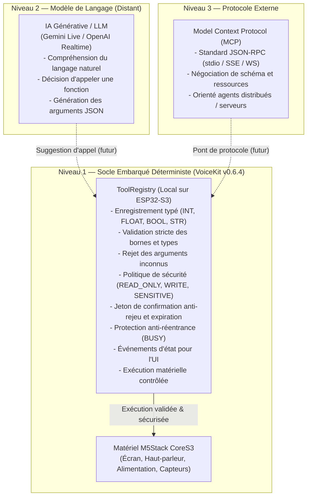

# Architecture : Registre Local d'Outils, Appel d'Outils IA et MCP

Ce document clarifie la distinction architecturale fondamentale entre :
1. **Le Registre Local d'Outils (*Local Tool Registry*)** — Composant natif introduit en **VoiceKit v0.6.4**.
2. **L'Appel d'Outils IA (*AI Function Calling / Tool Calling*)** — Mécanisme futur d'orchestration par modèle de langage.
3. **Le Protocole MCP (*Model Context Protocol*)** — Standard de communication client-serveur pour agents IA.

> [!IMPORTANT]
> **Avertissement de version (VoiceKit v0.6.4)** :
> Cette version implémente **exclusivement le Registre Local d'Outils**. Elle **n'implémente pas** de serveur MCP embarqué et **n'active pas** d'appels d'outils automatiques depuis Gemini Live ou OpenAI Realtime. Cette séparation stricte garantit la stabilité, le déterminisme et l'absence totale de régression sur le matériel embarqué M5Stack CoreS3.

---

## 1. Vue d'Ensemble des Trois Niveaux

---

## 2. Le Registre Local d'Outils (*Local Tool Registry*) — v0.6.4

### Rôle et Périmètre
Le Registre Local est un composant **100% embarqué, autonome et déterministe** résidant dans la mémoire de l'ESP32-S3 (`src/core/tools/`). Il fonctionne indépendamment de tout réseau Wi-Fi, de tout fournisseur vocal ou de tout modèle d'IA.

### Responsabilités
- **Inventaire structuré** : Enregistrement de commandes avec identifiant unique (ex: `audio.set_volume`), description lisible et typage des paramètres.
- **Validation contractuelle stricte** : Avant toute exécution, vérification de la présence des paramètres requis, conformité des types (`INT`, `FLOAT`, `BOOLEAN`, `STRING`), respect des plages de valeurs minimales/maximales, et rejet immédiat des paramètres inconnus (sauf autorisation explicite).
- **Politique de sécurité à 3 niveaux** :
  - `READ_ONLY` : Consultation sans altération d'état (ex: `system.get_status`).
  - `WRITE` : Action modifiant l'état autorisée sans confirmation (ex: `audio.set_volume`).
  - `SENSITIVE` : Action sensible nécessitant une **confirmation explicite obligatoire** (ex: `system.factory_reset`).
- **Protection anti-rejeu et expiration** : Les commandes sensibles génèrent un jeton unique (`CONF-xxx`) horodaté avec une durée de vie configurable. Tout jeton déjà consommé ou expiré est formellement refusé.
- **Contexte applicatif contrôlé** : L'exécution a lieu dans la boucle principale ou via un mécanisme différé non bloquant, jamais dans une interruption matérielle, un callback audio ou une tâche réseau critique.
- **Télémétrie événementielle** : Émission ordonnée d'événements (`TOOL_REQUESTED`, `TOOL_STARTED`, `TOOL_COMPLETED`, `TOOL_FAILED`, `TOOL_CONFIRMATION_REQUIRED`) pour découplage avec l'interface utilisateur.

---

## 3. L'Appel d'Outils par l'IA (*AI Tool Calling*) — Horizon Futur

### Rôle et Périmètre
L'appel d'outil par IA (souvent appelé *Function Calling*) est la capacité d'un modèle de langage (tel que Gemini 2.0 Live ou OpenAI Realtime) à :
1. Recevoir en configuration la description JSON des outils disponibles.
2. Détecter dans les propos de l'utilisateur l'intention de déclencher une action.
3. Émettre une trame structurée (`ToolCall`) contenant le nom de la fonction et les arguments inférés.

### Articulation avec le Registre Local
L'IA ne possède **aucune autorité d'exécution directe** sur le matériel. Elle est considérée comme un émetteur non fiable :
- L'IA peut halluciner des arguments inexistants, des valeurs hors limites ou des types erronés.
- Le **Registre Local sert de garde-fou impératif** : il intercepte la demande, valide chaque paramètre selon les spécifications strictes, vérifie les autorisations et impose la confirmation de l'utilisateur pour toute commande classée `SENSITIVE`.
- **En v0.6.4** : Ce pont automatique n'est pas encore activé afin de valider préalablement le socle déterministe local sans dépendre de l'API distante.

---

## 4. Le Protocole MCP (*Model Context Protocol*) — Horizon Futur

### Rôle et Périmètre
Le Model Context Protocol (MCP) est un standard ouvert conçu par Anthropic, visant à unifier la manière dont les applications fournissent du contexte (ressources, outils, invites) aux modèles d'IA via un protocole client-serveur formalisé (généralement basé sur JSON-RPC 2.0).

### Différences Clés avec le Registre Local

| Critère | Registre Local (VoiceKit v0.6.4) | Model Context Protocol (MCP) |
|---|---|---|
| **Nature** | API C++ native embarquée pour microcontrôleur | Protocole applicatif de communication client-serveur |
| **Cible d'exécution** | ESP32-S3 (FreeRTOS / Arduino, 320 KB RAM) | Serveurs locaux ou distants (Node.js, Python, IPC) |
| **Format des échanges** | Objets et types C++ en mémoire (`ToolArgs`, `ToolResult`) | Messages sérialisés JSON-RPC 2.0 |
| **Réseau / Transport** | Aucun requis (100% hors ligne) | Nécessite un canal de transport (stdio, SSE, WebSockets) |
| **Rôle** | Exécuter et valider des actions matérielles déterministes | Standardiser l'échange de catalogue d'outils et de contexte |
| **Présence v0.6.4** | **Implémenté et testé** | **Non implémenté (futur)** |

Dans une future évolution de VoiceKit, un serveur MCP embarqué ou un pont passerelle pourrait exposer le catalogue d'`ToolRegistry` vers un client MCP externe, mais `ToolRegistry` restera toujours le moteur d'exécution local garant de la sécurité matérielle.

---

## 5. Matrice Comparative Synthétique

| Fonctionnalité | Registre Local (v0.6.4) | Appel d'Outil IA (Futur) | MCP (Futur) |
|---|---|---|---|
| **Exécution hors ligne** | **Oui** (100%) | Non (requiert connexion LLM) | Dépend de la topologie réseau |
| **Déterminisme strict** | **Oui** (règles C++) | Non (probabiliste / LLM) | Protocolaire |
| **Validation des bornes** | **Oui** (min / max) | Déclarative uniquement | Déclarative (schémas JSON) |
| **Confirmation sensible** | **Oui** (jeton anti-rejeu) | Déléguée à l'application | Déléguée au client |
| **Consommation RAM** | $< 4$ KB | Tampons WebSocket distants | Pile JSON-RPC distante |
| **Statut VoiceKit v0.6.4** | **Disponible** | Préparé (fondation prête) | Non inclus |

