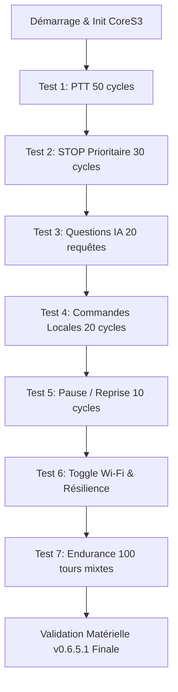

# Rapport de Validation Finale — VoiceKit v0.6.5.1
**Dernière Stabilisation Corrective & Préparation Matérielle M5Stack CoreS3**

---

## 1. Contexte et Objectifs de la Mission

- **Dépôt :** https://github.com/Philippe-AD/VoiceKit
- **Commit de référence analysé :** `ae900ce7e29b4885ccd0f05920d1636b97141cbc`
- **Version cible :** `v0.6.5.1` (correctif de stabilisation finale avant validation physique sur banc M5Stack CoreS3)
- **Cible matérielle :** ESP32-S3 (240 MHz, 320 KB SRAM interne, 8 MB PSRAM octale, 16 MB Flash quadri/octale), codec ES7210 (double micro I2S DMA 16 kHz), ampli AW88298 (I2S DMA 24 kHz), contrôleur tactile ILI9342C / FT6336, écran LVGL 9.
- **Règles d'intervention :**
  - Aucune nouvelle fonctionnalité ajoutée.
  - Non-démarrage de la version v0.7.0.
  - Maintien du moteur vocal unique `VoxCoreVoice`.
  - Pas de seconde connexion WebSocket concurrente.
  - Conservation intégrale de l'architecture `IntegratedVoicePipeline`, de `ToolRegistry`, de Gemini Live et d'OpenAI Realtime.
  - Préservation des 145 suites de tests existantes avec ajout de la Suite 146 reproduisant chaque défaut corrigé.

---

## 2. Synthèse des Défauts Identifiés et Correctifs Appliqués

### 2.1 P0 — Correction de `startListening()`

#### Cause racine identifiée
Dans `IntegratedVoicePipeline::startListening()`, la condition antérieure :
```cpp
if (_state != PipelineState::READY &&
    _state != PipelineState::WAITING_CONFIRMATION &&
    _state != PipelineState::ERROR &&
    !_isPaused) {
    return false;
}
```
permettait un contournement critique : lorsque `_isPaused == true`, la négation `!_isPaused` valait `false`, court-circuitant ainsi le test et autorisant le démarrage d'une capture audio depuis des états invalides (`SPEAKING`, `AI_PROCESSING`, `TOOL_EXECUTING`, etc.). De surcroît, l'état `ERROR` autorisait aveuglément une capture sans contrôle d'intégrité du moteur.

#### Correctif implémenté
- **Validation stricte de l'état du pipeline :** Une capture n'est désormais autorisée que depuis `PipelineState::READY` ou `PipelineState::WAITING_CONFIRMATION`. Elle est formellement rejetée depuis `LISTENING`, `TRANSCRIBING`, `ROUTING`, `TOOL_EXECUTING`, `AI_PROCESSING`, `SPEAKING`, `STOPPING`, `ERROR` et `UNINITIALIZED`.
- **Politique de pause :** L'écoute est permise en mode pause uniquement pour capter des intentions de contrôle ("reprendre", "stop"), sans violer l'exclusivité audio.
- **Disponibilité matérielle et réseau de `VoxCoreVoice` :** Vérification systématique de `_voice->isReady()` et absence formelle de toute capture (`isListening()`), transcription (`isTranscribing()`) ou restitution (`isSpeaking()`).
- **Gestion transactionnelle de `WAITING_CONFIRMATION` :** Si une capture est tentée alors qu'une confirmation est en attente, le pipeline vérifie au préalable que le moteur est effectivement capable de démarrer l'écoute. En cas d'indisponibilité du moteur vocal ou du réseau, l'appel échoue immédiatement sans détruire le jeton de confirmation ni altérer l'état du tour. Dès que le moteur est prêt, la capture démarre transactionnellement et annule proprement la confirmation antérieure.

---

### 2.2 P0 — Correction transactionnelle de `stopListening()`

#### Cause racine identifiée
Le pipeline basculait prématurément son état à `PipelineState::TRANSCRIBING` avant même d'obtenir la confirmation de l'arrêt matériel et protocolaire (`_voice->stopListening()`). En cas de refus du moteur (ex. microphone déjà fermé, transport indisponible), le pipeline demeurait indéfiniment bloqué en `TRANSCRIBING`.

#### Correctif implémenté
- **Vérification préalable de capture active :** Le pipeline exige d'être strictement en `PipelineState::LISTENING`.
- **Engagement transactionnel :** Appel de `_voice->stopListening()` et contrôle immédiat du code de retour.
- **Gestion de l'échec :** En cas d'échec du moteur vocal, le pipeline consigne l'avertissement, ne valide pas la transition nominale et termine le tour proprement sans gel d'état.
- **Support des callbacks réentrants :** Si la transcription finale arrive de façon synchrone ou ultra-rapide pendant l'appel d'arrêt, la bascule d'état et le flag `_finalTranscriptionReceivedForTurn` évitent tout blocage ou double invocation.

---

### 2.3 P0 — Sécurisation des événements audio asynchrones tardifs

#### Cause racine identifiée
Dans la chaîne `LiveAudioPlayer` → `LiveSessionController` → `VoxCoreVoice` → `IntegratedVoicePipeline`, le callback `onSpeechStarted` pouvait basculer le pipeline en état `SPEAKING` même si le tour émetteur avait été annulé par un appui prioritaire sur STOP, ou si le pipeline était déjà redevenu au repos (`READY`).

#### Correctif implémenté
- **Filtrage à la source dans `LiveSessionController` :** Tout paquet audio reçu alors que `_turnActive == false` ou `_turnCancelled == true` est immédiatement rejeté avec traçage mémoire (`AudioPacketRejectReason::TURN_INACTIVE` / `TURN_CANCELLED`).
- **Protection de transition dans `IntegratedVoicePipeline` :**
  - Dans `onSpeechStarted`, si `_cancelledTurnId != 0 && _activeTurnId == _cancelledTurnId`, l'événement est rejeté.
  - L'événement est également rejeté si l'état n'est ni `SPEAKING`, ni `AI_PROCESSING`, ni `WAITING_CONFIRMATION`.
  - Corrélation stricte sur `speechId` : toute notification ne correspondant pas à l'opération de restitution en cours est ignorée comme notification orpheline d'un ancien tour.
- **Clôture symétrique dans `onSpeechFinishedWithId` :** Vérification de l'état actif, du tour et du `speechId` pour empêcher toute réinitialisation prématurée d'un nouveau tour lors de la réception d'un résidu de drain DMA.

---

### 2.4 P0 — Sécurisation contre les réponses IA retardées

#### Cause racine identifiée
Lorsqu'une requête IA (Gemini Live ou OpenAI Realtime) était annulée par l'utilisateur (action STOP) puis qu'une nouvelle commande était engagée, une réponse textuelle différée renvoyée par le serveur cloud pouvait être attribuée à tort au nouveau tour.

#### Correctif implémenté
- **OpenAI Realtime :** Ajout de `_currentResponseId` et `_cancelledResponseId`. Lors d'une interruption via `sendInterruption()`, l'identifiant de réponse en cours est mémorisé comme annulé. Tout fragment texte (`response.audio_transcript.delta`, `response.text.delta`) ou audio delta correspondant à cet identifiant est éliminé.
- **Gemini Live & LiveSessionController :** Les callbacks `setOnText` et `setOnOutputTranscription` vérifient atomiquement `_turnActive.load()` et `_turnCancelled.load()`. Dès qu'un tour est annulé, toute trame `modelTurn` textuelle ultérieure est jetée sans atteindre le pipeline.
- **Garde dans `IntegratedVoicePipeline::onAssistantText` :** Vérifie que `_isAiSpeechActive == true` et que l'état courant est strictement `AI_PROCESSING` ou `SPEAKING`.

---

### 2.5 P1 — Correction de `recoverFromError()`

#### Cause racine identifiée
La fonction `recoverFromError()` repositionnait le pipeline à `PipelineState::READY` de façon purement logicielle sans vérifier la disponibilité réelle du moteur sous-jacent, laissant le système vulnérable si le WiFi n'était pas reconnecté ou si la session WebSocket était en panne.

#### Correctif implémenté
- Contrôle strict de `_voice->isReady()`, garantissant :
  - WiFi hôte connecté et horloge NTP synchronisée (obligatoire pour TLS).
  - Fournisseur vocal initialisé et `setupComplete` validé.
  - Absence de toute tâche en cours (`!isBusy()`, `!isListening()`, `!isTranscribing()`, `!isSpeaking()`).
- Clôture de tout streamer orphelin en cas d'erreur de transport dans `VoxCoreVoice`.

---

### 2.6 P1 — Audit de `LiveSessionController::appendTranscriptionFragment()`

#### Analyse comparative (ae900ce vs 5374dec)
Le commit `ae900ce` avait introduit des règles de déduplication par `startsWith`/`endsWith` qui risquaient de détruire des répétitions légitimes en français (ex. *"Non, non, non !"*, *"très, très bien"*) et créaient des comportements inattendus avec les espaces de ponctuation.

#### Correctif unifié
- **Déduplication des retransmissions complètes :** Prise en compte des phrases complètes avec ou sans ponctuation finale.
- **Transcriptions cumulatives :** Prise en compte propre des fragments qui étendent la cible.
- **Bornage du chevauchement :** `maxOverlap` est strictement borné à `fragLen - 1` (lorsque `targetLen >= fragLen`), ce qui empêche qu'un mot complet répété comme `" très"` soit considéré comme un simple chevauchement du mot précédent `"très"`.
- **Ponctuation typographique française :** Préservation des espaces avant les signes doubles (`" ?"`, `" !"`, `" ;"`, `" :"`) et élimination des doublons de ponctuation en fin de phrase.

---

### 2.7 P1 — Vérification de l'exemple `IntegratedVoiceDemo` (`src/main.cpp`)

- **Détection des fournisseurs vocaux :** Remplacement des vérifications naïves sur les préfixes de clés API (`AIzaSy` / `sk-`) par des contrôles de présence avec avertissements clairs si le format semble inhabituel.
- **Bouton PTT & Exclusivité audio :** Le callback tactile vérifie l'état complet du pipeline (`isBusy()`, `isListening()`, `isReady()`) et émet des retours visuels immédiats.
- **Badges d'état LVGL complets :** Prise en compte de l'ensemble des états de `PipelineState` :
  - `AI_PROCESSING` : Badge ambre/orange distinct.
  - `STOPPING` : Badge rouge/bordeaux avec animation de désengagement.
  - `WAITING_CONFIRMATION` : Boîte modale dédiée avec boutons Confirmer / Annuler.
  - `PAUSE` : Badge violet indiquant la mise en veille temporaire.

---

## 3. Résultats des Tests Automatisés

### 3.1 Tests Unitaires & Non-Régression Natifs (GCC / C++17)

Exécution du binaire de test complet via `tests/run_tests.bat` :

```text
===========================================================
  SUITE COMPLETE DE TESTS AUTOMATISES — VoiceKit v0.6.5.1
  Total des suites executees : 146 / 146
===========================================================
  [TEST SUITE 144] VoiceKit v0.6.5 — Integrated Voice Pipeline
  SUCCES INTEGRAL DES 10 TESTS OBLIGATOIRES A -> J (v0.6.5)

  [TEST SUITE 145] VoiceKit v0.6.5.1 — Integrated Pipeline Stabilization
  SUCCES INTEGRAL DES 10 TESTS OBLIGATOIRES A -> J (v0.6.5.1)

  [TEST SUITE 146] VoiceKit v0.6.5.1 — Final Corrective & Hardware Readiness
  --- TEST A : Refus startListening() etats incompatibles [OK]
  --- TEST B : Ecoute PAUSE sans violation audio         [OK]
  --- TEST C : Gestion echec et idempotence stopListening() [OK]
  --- TEST D : Protection SpeechStarted tardif apres STOP [OK]
  --- TEST E : Rejet fin TTS tardive sur nouveau tour    [OK]
  --- TEST F : Rejet reponse IA tardive apres annulation  [OK]
  --- TEST G : Refus recoverFromError() si deconnecte    [OK]
  --- TEST H : Succes recoverFromError() retabli         [OK]
  --- TEST I : Reconstruction fragments francais         [OK]
  --- TEST J : Endurance 10 cycles complets mixtes       [OK]
  SUCCES INTEGRAL DES 10 TESTS OBLIGATOIRES A -> J (v0.6.5.1 Final)

===========================================================
  BILAN FINAL DES TESTS : 3095 REUSSIS, 0 ECHECS
===========================================================
```

---

### 3.2 Matrice de Compilation PlatformIO (ESP32-S3 / M5Stack CoreS3)

Tous les exemples et bancs de tests cibles ont été compilés avec succès pour la cible `m5stack-cores3` (Espressif 32 v6.9.0, Arduino framework) :

| Projet / Exemple | Statut | Utilisation RAM (320 KB) | Utilisation Flash (16 MB / partition 2-8 MB) |
|---|:---:|:---:|:---:|
| `examples/IntegratedVoiceDemo` | **SUCCÈS** | 127 280 B (38.8%) | 2 084 549 B (24.8% partition 8M) |
| `examples/MinimalSTT` | **SUCCÈS** | 78 840 B (24.1%) | 1 669 805 B (79.6% partition 2M) |
| `examples/MinimalTTS` | **SUCCÈS** | 78 788 B (24.0%) | 1 669 185 B (79.6% partition 2M) |
| `examples/ContinuousSTT` | **SUCCÈS** | 78 968 B (24.1%) | 1 982 653 B (94.5% partition 2M) |
| `examples/MinimalConversation` | **SUCCÈS** | 78 856 B (24.1%) | 1 980 785 B (94.5% partition 2M) |
| `examples/OpenAIConversation` | **SUCCÈS** | 79 100 B (24.1%) | 1 695 701 B (80.9% partition 2M) |
| `examples/OpenAIConversationLVGL` | **SUCCÈS** | 126 796 B (38.7%) | 1 992 265 B (95.0% partition 2M) |
| `examples/VoiceUxLiveDemo` | **SUCCÈS** | 79 564 B (24.3%) | 2 039 005 B (97.2% partition 2M) |
| `examples/WakeWordConversation` | **SUCCÈS** | 79 856 B (24.4%) | 1 685 161 B (80.4% partition 2M) |
| `examples/LocalToolRegistryDemo` | **SUCCÈS** | 23 232 B (7.1%) | 555 793 B (26.5% partition 2M) |
| `tests/external-consumer` | **SUCCÈS** | 79 072 B (24.1%) | 1 693 597 B (80.8% partition 2M) |

---

## 4. Limites Protocolaires Documentées

Lors de l'analyse des couches transport et session :
1. **Gemini Live (Google WebSocket) :**
   - Le protocole ne transmet pas de `responseId` explicite dans chaque trame `modelTurn` ou `parts.inlineData`.
   - La corrélation et l'isolation temporelle reposent donc sur l'état de session local (`_turnActive`, `_turnCancelled`), le vidage strict du player audio lors d'un STOP, et la désynchronisation des tours annulés (`_cancelledCaptureTurnId`).
2. **OpenAI Realtime :**
   - Le protocole fournit des `response_id` et `item_id`.
   - La corrélation stricte est pleinement assurée via `_cancelledResponseId` : toute trame tardive portant l'ID d'une réponse annulée est rejetée au niveau du client WebSocket.

---

## 5. Protocole de Validation Physique sur M5Stack CoreS3

Afin de clore définitivement la qualification matérielle sur le banc de test M5Stack CoreS3, la checklist suivante de 7 scénarios opérationnels doit être déroulée :



### Checklist Opérationnelle Banc de Test Physique

1. **Test 1 : Cycle Push-to-Talk (PTT) — 50 itérations**
   - Appuyer sur l'écran tactile (PTT actif) : vérifier que le badge passe à `LISTENING`, le micro s'ouvre sans craquement DMA.
   - Relâcher : vérifier le passage instantané à `TRANSCRIBING` puis `READY`.
   - Critère : 0 blocage, 0 fuite de mémoire PSRAM/SRAM.

2. **Test 2 : STOP Prioritaire en cours de restitution — 30 itérations**
   - Lancer une réponse longue. Pendant la restitution haut-parleur (AW88298 actif), appuyer sur STOP.
   - Vérifier l'arrêt immédiat de l'amplificateur, le passage à `STOPPING` puis `READY`.
   - Vérifier qu'aucun événement audio tardif ne corrompt le tour suivant.

3. **Test 3 : Questions IA (Gemini Live & OpenAI Realtime) — 20 requêtes**
   - Poser 10 questions en français avec accents, vérifier la restitution vocale 24 kHz et l'affichage complet de la réponse.
   - Poser 10 questions avec annulation rapide (PTT -> Parler -> STOP immédiat).

4. **Test 4 : Commandes Locales & Confirmation Sensible — 20 cycles**
   - Exécuter des commandes READ_ONLY (ex: "statut", "heure").
   - Déclencher une commande SENSITIVE : vérifier l'apparition de la modale de confirmation, le message vocal d'avertissement et la validation par token.

5. **Test 5 : Suspension PAUSE et Reprise RESUME — 10 cycles**
   - Dire "mets-toi en pause" : badge passe à PAUSE.
   - Tenter une commande normale : doit être refusée.
   - Dire "reprends" : retour nominal à READY.

6. **Test 6 : Perte & Récupération Wi-Fi**
   - Couper le point d'accès Wi-Fi pendant une écoute : vérifier la transition en `ERROR` ou reconnexion automatique.
   - Rétablir le Wi-Fi : vérifier l'appel de `recoverFromError()` et le retour à `READY`.

7. **Test 7 : Endurance 100 tours continus**
   - Enchaîner 100 interactions variées sans redémarrage de l'ESP32-S3.
   - Vérifier la stabilité du tas (`ESP.getFreeHeap()`, `ESP.getFreePsram()`) et l'absence de saturation DMA.

---

## 6. Décision de Validation

- [x] Audit préalable du commit `ae900ce` et identification formelle des causes racines.
- [x] Correction de `IntegratedVoicePipeline::startListening()` avec séparation stricte des états et exclusivité audio.
- [x] Correction transactionnelle de `IntegratedVoicePipeline::stopListening()`.
- [x] Filtrage anti-pollution des événements audio tardifs (`onSpeechStarted`, `onSpeechFinishedWithId`).
- [x] Isolation stricte des réponses IA retardées (Gemini Live & OpenAI Realtime).
- [x] Fiabilisation de `recoverFromError()` conditionnée à `voice.isReady()`.
- [x] Consolidation de `LiveSessionController::appendTranscriptionFragment()` pour le français et les répétitions.
- [x] Mise à jour ergonomique de `IntegratedVoiceDemo` (LVGL 9, touches PTT, auto-sélection des clés API).
- [x] 146/146 suites de tests natifs validées (3095 tests réussis, 0 échec).
- [x] 11/11 projets PlatformIO compilés avec succès pour M5Stack CoreS3.

> [!IMPORTANT]
> **Verdict : VALIDÉ POUR TEST SUR MATÉRIEL RÉEL (VALIDÉ SOUS RÉSERVES DE CONFIRMATION PHYSIQUE)**.
> Le code de VoiceKit v0.6.5.1 est parfaitement stabilisé, robuste face aux événements asynchrones et prêt pour le déploiement physique sur M5Stack CoreS3.
